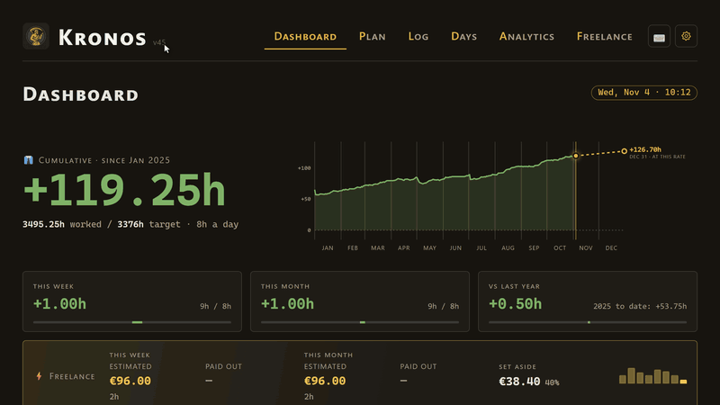

# Kronos ⏱️

> A self-hosted work-hours tracker for people who don't want to open a spreadsheet every morning —
> and, if you also freelance on the side, what those hours are really worth after tax.

Single-user. No auth. One SQLite file. Runs as a Docker container behind your own reverse proxy.

[](LICENSE)
[](https://www.python.org/)
[](https://fastapi.tiangolo.com/)
[](#tests)



---

## The idea

You have a contracted number of hours per day. Some days you work more, some less. Kronos
answers one question — **am I ahead or behind, and by how much?** — for this week, this month,
and every day since you started tracking.

Log a day in a few seconds, then get out of the way.

If you also work as a freelancer (an *autónomo*, by the hour, maybe paid in dollars), Kronos
logs those hours next to the working day — with their own rate, never touching the employee's
balance — and answers the second question: **what is the freelance side really worth** after
Social Security and income tax, quarter by quarter, and what would a rate have to be.

---

## Features

### Logging

- **One row per date.** Every day is `work`, `vacation`, `sick`, `holiday`, or `flex`
- **Work days** carry a start time, an end time, and any number of breaks — entered as a
  time range or as raw minutes
- **Partial leave.** A leave day can cover only part of the day — 3h of vacation, a 2h
  sick leave — with the hours worked in the rest of it logged on the same row. The Log tab
  has a slider in hours; the rest of the app shows `vacation · 3h`
- **Clock in / clock out** stamps the current time into the form, for logging as you go
- **Bulk logging** applies one non-work type across a whole date range in a single call
- **Day templates** stored server-side — one click fills a recurring shift
- **Public holiday import** by country and region, with a preview before anything is written
  (Spain from the official BOE list; other countries via [Nager.Date](https://date.nager.at/))
- **Free-text notes** per day, searchable across all entries
- **Freelance blocks** — several per day if need be, each with its hours (or a start and an
  end), a note and an income source; added, edited and removed from a panel under the Log form
  in two taps, with Undo. A block takes its source's rate and currency when it is saved, and a
  dollar block the ECB rate of its own day, so a later rate never rewrites the past. They count
  for nothing on the employee side: not the target, not the balance, not the streaks, not the
  timesheet

### The numbers

- **Week, month, and cumulative surplus/deficit** against your daily target
- **Year-over-year** — this year against the same period last year
- **Date-effective daily target.** If your contract changed mid-year, the target is a timeline,
  not a single number: every day is measured against the target in force *on that date*, so
  cumulative totals spanning the change stay correct
- **Non-work days zero out that day's target**, so period totals adjust on their own. A
  partial leave day zeroes only its leave share (3h off an 8h day leaves a 5h target for the
  hours you worked). `flex` days are the exception — they still charge the whole target,
  draining the surplus you banked
- **Vacation budget** tracking against an annual allowance, in fractional days (a 3h
  vacation on an 8h day uses 0.375 of it; budgets can be 22.5)
- **Time-off planner.** Pencil in vacation, holidays and flex days on a calendar before they
  happen and see where the balance lands at Dec 31 — *on target* (only leave moves it: flex
  drains, vacation is neutral) or *at your pace* — and how much of the vacation budget the plan
  leaves. Drafts don't touch the numbers until you commit them, block by block, with their notes.
  They show as dashed ghost days on every calendar, and the dashboard forecast counts them
  instead of assuming you'll take the whole remaining budget
- **Analytics tab** — a year-at-a-glance heatmap first (hover a day for its hours, Δ and
  note; click to open it in Log; a switch shows the freelance hours instead; once it scrolls
  away a compact copy stays pinned at the top with the switch and the year), then the
  **balance over time**: a chart you zoom by drawing a rectangle on it (wheel zooms at the
  cursor, shift+drag and the strip below pan, double-click resets; pinch and drag on the phone),
  with presets from *this month* to *all*, and a switch between the cumulative balance, net
  hours per day and per month — freelance hours stacked on the employee's bars — and freelance
  income per month. Whatever range the chart shows drives the rest of the page: the range's
  totals in a ledger (the freelance side too: billed, hours, €/h gross and after tax), the
  weekday pattern (Δ and average start → end), the distribution of daily surplus, and the
  records. The yearly table keeps carry-in between years
- **Freelance tab** (once an income source exists) — *this year, for real*: the gross billed,
  hours, €/h gross and net, each month as a bar, the **modelo 130** quarter by quarter (20 % of
  the net yield since 1 January less what earlier quarters paid, with its deadline and status),
  and the year carried to Dec 31 from the hours you plan to bill a week: gross → expenses → RETA
  (its tramo) → IRPF → net. Then a **rate calculator**: hourly ⇄ daily ⇄ net yearly, three
  linked fields (with a shortcut to the freelance options and back: change an input, see what it
  does), in euros or dollars at the ECB's rate or one you type, every assumption on view
  (billable days — 220 or the calendar's —, hours a day, the salary of the job, expenses, tarifa
  plana, start-up reduction), with the waterfall of where each euro goes and how the IRPF is
  paid. One source of tax maths: `backend/app/services/tax.py` with the year's figures in
  `backend/app/data/fiscal_es.json` (Spain, Andalucía; estimates — check with an adviser). The
  browser shows what the API computes and keeps no copy of the formulas

### The app itself

- **Dashboard** — one number (the cumulative balance) next to its **trajectory**: the balance
  day by day this year, then a dashed line to where it lands on Dec 31 at this rate. Week,
  month and *vs last year* as three chips; the current week as a strip of seven tiny bar
  charts (a day opens in Log); the vacation budget as notches (used · planned · left);
  quick-log pills only while today has no entry. With an income source, a freelance card: hours
  and gross this week and this month, what to set aside for the tax office, eight weeks of
  hours as a sparkline
- **Logging and on-target streaks**, with milestone toasts at 30 / 100 / 365 days
- **Plan tab** — a year strip of twelve mini months picks the working month; click or drag to
  draft, one ledger for drafts and the time off already logged ahead (commit, remove, delete,
  or open a day in the Log tab from there; logged and past days on its calendar open in Log too)
- **Log** tab — the same year strip picks the month, a calendar picks the day; the **Employee**
  card (type, times, breaks, notes) and, with an income source, the **⚡ Freelance** card under
  it. **Days** tab for the full searchable history — a dense table, a row opens its day, a
  separator with the subtotal per month, notes always visible in the last column; with a
  source, an **Employee · ⚡ Freelance** switch, the freelance side filtered by source (none,
  one, several, all) with the selection's total
- **Settings** behind the gear next to the theme toggle: three groups — **Employee** (Work,
  Leave, Holidays, Profile, Templates), **Freelance** (income sources and rates, taxes per year,
  the projection, the currency) and **General** (Data) — a section index under the open group
  (two dropdowns on the phone), a card per section. No save buttons: a field saves itself half
  a second after you stop typing, a switch at once, and the card says *saved ✓*
- **Command palette** (<kbd>.</kbd>), keyboard shortcuts, a dark brass look
- **PWA-installable**, with a service worker for the app shell
- **CSV import/export** and full JSON backup/restore
- **Currency** — sources bill in euros or dollars; everything is added up in euros with the
  European Central Bank's reference rate, asked for only when a view needs it (see *A note on
  exchange rates*)
- **A CLI for agents** — `bin/kronos.py` reads and logs days through the HTTP API from a
  terminal, a script or a bot: `today`, `balance`, `days`, `plan`, `log`, `clock in|out`,
  `holidays import`, `backup` / `restore`, each with `--json` and `--dry-run`, against
  `local`, `int` or `prod` — a write to prod takes a backup first
- **Printable timesheets** (Days → **PDF**, and **⚡ PDF** on the freelance side: the blocks of
  a range for the sources you tick, in their currency and in euros) — a month, a year, or any
  range as a clean A4 document:
  every calendar day, hours as 7.50 or 7:30, *Compact* (hours only) or *Full* (target, Δ, running
  Σ), optional notes column and signature lines, light or dark, your name and employer from
  Settings → Profile. Month sections with subtotals when the range spans months; "not logged"
  flags a past work day without an entry. The browser's *Save as PDF* is the PDF — no
  server-side dependency

### Keyboard

| Key | |
|---|---|
| <kbd>P</kbd> <kbd>L</kbd> <kbd>D</kbd> <kbd>A</kbd> <kbd>F</kbd> <kbd>S</kbd> | Plan · Log · Days · Analytics · Freelance · Settings — the accented first letter of a tab is its key |
| <kbd>.</kbd> | Command palette |
| <kbd>Ctrl</kbd>+<kbd>Enter</kbd> | Save the current form |
| <kbd>Esc</kbd> | Close an overlay, leave a field, cancel an edit — otherwise back to the Dashboard from any tab |

---

## Stack

| Layer | Tech |
|---|---|
| Backend | FastAPI · SQLAlchemy 2 · Alembic · Pydantic |
| Frontend | Jinja2 · Alpine.js · Pico CSS — the charts are hand-drawn SVG |
| Storage | One SQLite file (WAL mode) on a Docker volume |
| Vendored | Every JS/CSS dependency lives in `backend/static/vendor/` — **no build step, no CDN calls, no npm** |

---

## Quick start

### Docker

```sh
git clone https://github.com/Loadge/kronos.git
cd kronos
docker compose up -d
```

Open **http://localhost:8765**. First boot runs `alembic upgrade head` and seeds default settings.

The build runs the test suite (everything except the Playwright e2e tests) in an intermediate
`test` stage, and the `runtime` image copies a marker file out of it — so the tests always run,
and if any fail, or none are collected, you don't get an image and the running container is left
alone.

### Reverse proxy

Point your proxy at `http://<host>:8765`. Uvicorn runs with `--proxy-headers`, so the real
client IP reaches the logs.

```nginx
location / {
    proxy_pass         http://127.0.0.1:8765;
    proxy_set_header   Host $host;
    proxy_set_header   X-Real-IP $remote_addr;
    proxy_set_header   X-Forwarded-For $proxy_add_x_forwarded_for;
    proxy_set_header   X-Forwarded-Proto $scheme;
}
```

Works with NGINX Proxy Manager, Caddy, Traefik, and friends.

### Local development

Requires Python 3.12+.

```sh
make install          # pip install -r requirements-dev.txt
make migrate          # alembic upgrade head
make seed             # ~3 months of realistic sample data
make run              # uvicorn on :8765 with --reload
```

---

## Configuration

Environment variables:

| Var | Default | |
|---|---|---|
| `APP_PORT` | `8765` | Internal and published port |
| `TZ` | `Europe/Madrid` | Decides what "today" means everywhere in the app |
| `KRONOS_DATA_DIR` | `/app/data` (container) · `./data` (local) | Where `kronos.db` lives |
| `DATABASE_URL` | derived from `KRONOS_DATA_DIR` | Full override for the SQLAlchemy URL |
| `KRONOS_FX_URL` | the ECB's daily XML | Where the EUR/USD rate comes from; `""` switches every fetch off (tests, an air-gapped Kronos). `KRONOS_FX_HIST90_URL` / `KRONOS_FX_HIST_URL` override the two dated documents |

Everything else is runtime-editable from the Settings tab or `GET`/`PUT /api/config`, and lives
in the `settings` key-value table:

| Setting | Default | |
|---|---|---|
| `daily_target_hours` | `8.0` | Today's contracted hours per work day |
| `daily_target_timeline` | *(derived)* | JSON `[{effective_from, hours}, …]` — the date-effective target history. Editing the single field above appends to this without destroying past rows |
| `cumulative_start_date` | `2025-01-01` | Where the all-time running total begins |
| `reset_annually` | `false` | Auto-advance the cumulative start to Jan 1 each year |
| `work_week_days` | Mon–Fri | Which weekdays count toward the schedule |
| `vacation_budget_days` | `0` | Annual vacation allowance shown on the dashboard; halves allowed (`22.5`) |
| `default_start_time` · `default_end_time` | `09:00` · `17:00` | Pre-filled on the Log tab |
| `holiday_country` · `holiday_region` | *(none)* | Selection remembered for holiday import |
| `profile_name` · `profile_employer` · `profile_extra` | *(empty)* | Printed in the timesheet header; blank lines are left out |
| `freelance_hours_per_week` · `freelance_days_off` | `0` · `0` | The Freelance tab's projection to Dec 31: the hours you plan to bill a week, and the days off a year (spread over it) |

The freelance side keeps its own tables, edited from Settings → Freelance or the API: **income
sources** (name, hourly rate, EUR or USD, one default; a source with blocks is archived, not
deleted) and the **tax inputs per year** (the gross salary of the job held at the same time,
tarifa plana, the 20 % start-up reduction, the share of each payment set aside — 40 % by default
—, gestoría and other deductible expenses). A year without values of its own uses the latest
earlier year's. The fiscal figures themselves (RETA tramos, IRPF scales, the 130's deadlines)
live in `backend/app/data/fiscal_es.json`, one block per year; a year without a block uses the
latest earlier one, and the page says so.

### A note on exchange rates

Kronos never calls the European Central Bank on a timer. It asks when a view needs a rate —
Settings → Currency, the calculator in dollars — and when a dollar block is saved, for the rate
of that block's own date (a weekend takes Friday's); each document at most once an hour. The
block keeps that rate for good, editable by hand, so an old amount never moves. A block saved
while the ECB is unreachable counts its hours but not its money until you set a rate. Set
`KRONOS_FX_URL=""` to switch fetching off entirely.

### A note on the target timeline

If you've always worked the same hours, ignore this — the single "Daily target hours" field is
all you need.

If your contract changed (say 8h → 6h in June), set it under *Advanced: my contracted hours
changed over time*. Without it, a single global target silently misprices every day on the other
side of the change, and your cumulative balance is wrong by hundreds of hours. With it, each day
resolves against the row in force on that date.

---

## Data and backups

The database is `kronos.db` at **`/app/data/`** inside the container, on the **`kronos-data`**
named volume.

- **From the UI** — Settings → General → *Download backup* writes a portable JSON snapshot
  (entries, planner drafts, freelance sources / blocks / tax years, settings) that *Restore from
  file* reads back. CSV import/export sits next to it.
- **From the API** — `GET /api/backup` and `POST /api/restore`.
- **From the host:**

  ```sh
  docker run --rm -v kronos-data:/data -v "$PWD":/out alpine \
    sh -c 'cp /data/kronos.db /out/kronos-$(date +%F).db'
  ```

> Restore **wipes existing data first**. SQLite checkpoints the WAL on connection close; for a
> tighter guarantee, stop the container before copying the file directly.

Backups are **version 4** since the freelance payouts (what each source paid for each ISO week,
with its exchange rate); version 3 brought the freelance side: the income sources (with their
ids, which the blocks and payouts reference), the hour blocks with the rate, currency and
exchange rate they were saved with, and the tax inputs per year; version 2 added every entry's
`fraction`. Older
files still restore (whole days, no freelance); an older Kronos refuses a newer file rather than
silently dropping what it does not know. The entries CSV has a `fraction` column for the same
reason — a CSV without it imports as whole days — and the freelance blocks have a CSV of their
own (`GET /api/freelance/export.csv`, export only).

---

## The CLI

`bin/kronos.py` is how an agent — an agentic coder, a chat bot — reads and logs days without
clicking the UI or touching the database. It talks **only to the HTTP API** of a running Kronos
and needs nothing beyond the standard library.

```sh
python bin/kronos.py today                                  # today's day, the balances, the streaks
python bin/kronos.py balance                                # week / month / cumulative
python bin/kronos.py days --month 2026-10                   # a month (or --from/--to)
python bin/kronos.py plan --year 2026                       # drafts + where Dec 31 lands
python bin/kronos.py config

python bin/kronos.py log today --start 8:30 --end 16:45 --break 45 --note "lab"
python bin/kronos.py log 2026-10-28 --type vacation --hours 4 --start 9:00 --end 13:00
python bin/kronos.py log 2026-12-24..2026-12-31 --type vacation --dry-run
python bin/kronos.py clock in                               # the server stamps its own time
python bin/kronos.py clock out --break 13:00-13:45
python bin/kronos.py clock out --date yesterday --at 16:45   # another day always needs --at
python bin/kronos.py plan add 2026-12-24..2026-12-26 --type vacation --note "trip"
python bin/kronos.py plan commit --year 2026
python bin/kronos.py holidays import --country ES --region ES-MD --year 2027
python bin/kronos.py backup --out snap.json
python bin/kronos.py restore snap.json --yes
python bin/kronos.py --target prod --json today
```

- **Targets.** `--target local|int|prod` (default `local`). URLs come from `KRONOS_LOCAL_URL`,
  `KRONOS_INT_URL`, `KRONOS_PROD_URL` — in the environment or in a git-ignored `kronos.env`
  next to the repo root (copy `kronos.env.example`); the environment wins. `local` falls back to
  `http://localhost:8765`; `int` and `prod` must be set. `kronos targets` shows what resolved.
- **`--json`** on every command prints the API's own payloads (errors as `{"error", "exit"}`).
- **`--dry-run`** on every write prints the request and asks the server what the day *would*
  look like (`POST /api/entries/preview`, `dry_run` on the clock endpoints, the holiday
  preview) — nothing is written.
- **A write to `prod` takes a backup first** — `GET /api/backup` into `backups/prod/` (or
  `KRONOS_BACKUP_DIR`), the newest 50 kept — and refuses to go on if that fails. `restore`
  wipes before loading, so it takes that backup on every target and needs `--yes`.
- `log` on a date that is already logged fails unless `--replace`; a range of dates takes one
  leave type and never overwrites. Dates are `2026-10-27`, `today`, `yesterday` or `A..B`.
- `check` is a GET-only report of every read the CLI relies on — safe on prod; the deploy
  scripts run it after `smoke.py`.
- Exit codes: 0 ok · 1 the API refused · 2 usage · 3 target unreachable (or the backup failed).

---

## API

Interactive docs at `/docs` once it's running.

**Entries**

| | |
|---|---|
| `POST /api/entries` | Create a day (with breaks; `fraction` < 1 — or `leave_hours` — for partial leave) |
| `POST /api/entries/preview` | The day this body would produce, validated and computed, written nowhere (`exists` flags a taken date) |
| `POST /api/entries/batch` | Apply one non-work type across many dates (optional `fraction` or `leave_hours`, `notes`) |
| `GET /api/entries` | List, optional `from`/`to` range |
| `GET · PUT · DELETE /api/entries/{date}` | Read, full replace (atomic break-set swap), delete |
| `POST /api/clock/in` · `/api/clock/out` | Start / finish today's work day with the **server's** clock in `TZ` (`at`, `date`, `breaks`, `dry_run`); another day than today needs `at` — there is no "now" on it |

Wherever a request takes a `fraction`, it takes `leave_hours` instead: the server converts
using the target in force on that date ("3h of vacation" rather than 0.375), per date in a
batch.

**Analytics**

| | |
|---|---|
| `GET /api/dashboard` | Week + month + cumulative summary |
| `GET /api/streaks` | Logging streak, on-target streak, all-time days logged |
| `GET /api/analytics/cumulative?as_of=` | Balance as of a date (API only — no UI since 2026-10-01) |
| `GET /api/analytics/cumulative-series?year=` · `?all=true` | The balance after each logged day of a year, plus what was carried into it (the dashboard's trajectory) — or the whole history, restarting each January 1st when the cumulative resets annually (the Analytics chart) |
| `GET /api/analytics/monthly` · `/yearly` | One row per calendar month / year |
| `GET /api/analytics/records` | Longest day, best month, longest streak, best/worst year |
| `GET /api/analytics/yoy` | This year vs. the same period last year |

**Configuration**

| | |
|---|---|
| `GET · PUT /api/config` | All app-level settings |
| `GET · PUT /api/config/daily-target-schedule` | The date-effective target timeline |

**Freelance**

| | |
|---|---|
| `GET · POST /api/freelance/sources` · `PUT · DELETE /api/freelance/sources/{id}` | Income sources (a source with blocks is a 409 on delete: archive it) |
| `GET /api/freelance/blocks?from&to&year` · `POST /api/freelance/blocks` | Hour blocks; `hours` or `start_time` + `end_time`, optional `rate` and `fx_rate` overrides |
| `GET · PUT · DELETE /api/freelance/blocks/{id}` | A block keeps its stored rate and exchange rate unless told otherwise |
| `GET /api/freelance/tax-years` · `GET · PUT · DELETE /api/freelance/tax-years/{year}` | The tax inputs in force for a year (own, inherited, or the defaults) |
| `GET /api/freelance/summary?year=` | Totals, this week and month, per month and source, the four 130s, the projection and its tax figures |
| `POST /api/freelance/calc` | The calculator: hourly ⇄ daily ⇄ net yearly with every assumption in the body; pure |
| `GET /api/freelance/export.csv` | One row per block |
| `GET /api/fx` · `GET /api/fx?date=` | The ECB's EUR/USD reference rate, latest or the one in force on a date; always 200, `available` says whether there is one |

**Data in and out**

| | |
|---|---|
| `GET /api/export.csv` · `/api/export.json` | Download entries |
| `GET /timesheet?from&to&detail&hours&notes&sign&theme` | The printable timesheet (HTML, not JSON) — every switch is a query parameter, so a URL is a report |
| `GET /timesheet/freelance?from&to&sources&hours&notes&sign&theme` | The freelance timesheet: one row per block for the sources listed (ids, comma-separated; every source when absent) |
| `POST /api/import/csv` | Bulk import from a Kronos-format CSV |
| `GET /api/backup` · `POST /api/restore` | Full JSON snapshot / restore (entries, settings, planner drafts) |
| `DELETE /api/data` · `POST /api/data/seed` | Wipe / sample data (admin, testing) |

**Time-off planner**

| | |
|---|---|
| `GET /api/plans?year=` · `POST /api/plans` | Drafts; draft one leave type across dates (re-drafts, skips logged dates; `fraction` or `leave_hours`) |
| `PUT · DELETE /api/plans/{date}` | Change a draft's type / share / note, or drop it |
| `POST /api/plans/commit` | Turn drafts into real entries (an existing entry wins) |
| `GET /api/plans/projection?year=` | Balance at Dec 31 on target and at pace, vacation left after the plan |

**Holidays and templates**

| | |
|---|---|
| `GET /api/holidays/countries` · `/subdivisions` | Lookups, proxied from Nager.Date (Spain's regions: the BOE table) |
| `GET /api/holidays/preview` · `POST /api/holidays/import` | Preview, then commit |
| `GET · POST /api/templates` · `DELETE /api/templates/{id}` | Day templates |

`GET /healthz` backs the container healthcheck.

---

## Tests

```sh
make test             # pytest — in-memory SQLite, no container needed
make lint             # ruff check + format --check
make e2e              # Playwright end-to-end suite (see below)
make check            # lint, then test, then e2e — what to run before a deploy
```

**707 passing**, across four suites:

| Suite | |
|---|---|
| **Unit** | Net-hours math, break conversions, ISO week/month boundaries, `DayType`, `WorkEntry` properties, the daily-target schedule value object, settings service, partial-day target/net/summary math, the time-off projection, the timesheet rows / totals / hour formatting, the tax engine (two reference cases worked by hand to the cent, the RETA tramos, the IRPF scales, the quarterly 130, the one rounding rule), the freelance sums and the weeks left in a year, the CLI's pure parts (target resolution — env beats file, `int`/`prod` must be set — the `kronos.env` parser, date / time / break arguments, the request `log` builds, backup retention and the fail-closed safety backup) |
| **API** | Every router — happy paths plus validation failures: duplicate date, end ≤ start, break longer than the span, day-type transitions, invalid config, what a partial leave day may carry, fraction round-trips through backup and CSV, `leave_hours` resolving per date against the schedule, the preview that writes nothing, clock in / out with a pinned server clock, gzip and the vendor cache headers, the ECB rate (once an hour, stale, unavailable, of a date), the freelance side (sources and archiving, blocks with their rate snapshot and the missing-rate path, tax years and inheritance, a year's summary by hand, the calculator's two anchors to the cent, the CSV) — and that none of it moves the dashboard or the timesheet |
| **Integration** | Full CRUD flows, dashboard recalculation after state changes, cross-month weeks, export/import round-trips |
| **Regression** | Cumulative start boundary, `as_of` inclusivity, float precision, backup field fidelity (backup → wipe → restore → backup is identical, freelance sources / blocks / tax years included), orphaned-break FK, the non-work zero-target invariant, CSV quoting, per-date target resolution |
| **Repo hygiene** | The models and the Alembic migrations describe the same schema (Alembic runs in-process on an in-memory database; autogenerate finds nothing to add after `upgrade head`); no phase numbers in code; no file mixes line endings |

### End-to-end

163 tests drive a real browser — or the CLI as a subprocess — against a real uvicorn server: cross-tab journeys,
viewport/responsive checks, the dashboard (hero, trajectory, week strip, quick-log, vacation
notches, the freelance card), Settings groups and sections saving on their own (two dropdowns on
the phone), the Days table (month separators, row click,
notes), the Analytics chart (rectangle and wheel zoom, reset, presets, series switch, the range
driving the ledger, weekday times, histogram and records, the heatmap tooltip and click, the
freelance switch and stacked bars), the
Analytics section order, keyboard rules (Escape, no caret after a tab click), the partial-leave slider, the planner (click, drag, commit,
notes, delete, opening days in Log, ghosts on the Log calendar), the freelance side (nothing on
the page until a source exists, the Log panel adding / editing / removing a block with Undo
without moving the employee's day, the tab's year and 130s, the calculator typing in the
side-job anchor and reading 19,938.23 € back), the timesheet picker and page
(including Chromium's own PDF printer), the smoke script itself, and the CLI: every read and
write with its `--dry-run` (nothing written) and `--json`, the error contract, `check` green
against the server and red against a dead port, and the prod rule simulated by URL —
`KRONOS_PROD_URL` aimed at the test server leaves a valid snapshot taken *before* the write,
aimed at a dead port exits 3 with nothing written and no file, `int` takes no backup, `restore`
backs up everywhere, retention keeps exactly 50. Excluded
from `make test` and from the Docker build (no browser in the image), so `deploy.sh` and
`deploy-staging.sh` run them locally and abort if they fail or collect nothing.

```sh
pip install pytest-playwright
playwright install chromium

pytest tests/e2e -v            # headless
pytest tests/e2e -v --headed   # watch it work
```

### Smoke test

`bin/smoke.py <url>` runs GET-only checks against a running Kronos — `/healthz`, the page,
`app.js`, the dashboard/analytics/planner/freelance endpoints and the timesheet, each with its
expected shape — plus a
negative control that must return 404, so a proxy answering 200 to everything cannot fake a
pass. Both deploy scripts run it after the container is healthy and fail if it does, then
`python bin/kronos.py check` — the CLI's own GET-only report against the same URL.

```sh
python bin/smoke.py https://kronos.example.com   # or: make smoke SMOKE_URL=...
```

### Reviewing a checkout in one go

`bin/review_sandbox.sh` runs what a review needs — ruff, the pytest suites, an Alembic
upgrade/downgrade round trip, `--e2e` for the Playwright suite — and with `--serve` seeds a
throwaway demo DB and serves the app on `http://localhost:8799` (`--quick` skips straight to
that). Made for the Taiga sandbox: no Docker, no network, never touches `data/`.

```sh
bash review_sandbox.sh kronos_coding_behaviors --e2e     # every check on that folder
bash review_sandbox.sh kronos_coding_behaviors --quick   # just look at it on :8799
```

Without a folder it takes `./kronos_coding_behaviors` if there is one, else its own checkout.

### kctl — a disposable Kronos for verifying changes

`bin/kctl.py` starts Kronos on a fresh temporary SQLite DB (never `data/`), so an agent or a
human can check a change without touching real data:

```sh
python bin/kctl.py up --seed                                   # ~3 months of sample data
python bin/kctl.py api GET /api/analytics/monthly
python bin/kctl.py shot "/#analytics" --out .artifacts/analytics.png [--viewport phone]
python bin/kctl.py down                                        # kill it, delete the temp DB
```

---

## Security posture

Kronos assumes a **trusted network** — a VPN, or a private reverse proxy.

- **No auth layer.** The network is the access control
- **No cookies**, so no CSRF surface
- **JSON-only mutation API**, Pydantic-validated on every field
- Container runs as **non-root** (`kronos`, uid 1000)

> ⚠️ Do not put this on the open internet as-is. Put Cloudflare Access, Authelia, or plain
> Basic Auth in front of it — the app itself has no authentication and never checks who you are.

---

## Migrations

```sh
make migrate                           # apply pending
make revision MSG="add new column"     # autogenerate a new one
```

Alembic runs with `render_as_batch=True`, so SQLite-unfriendly `ALTER TABLE` operations (drop
column, alter type) rebuild the table correctly. Settings that are pure key-value — the target
timeline, the dashboard layout — are stored as JSON and need no migration at all.

---

## Layout

```
kronos/
├── backend/
│   ├── app/
│   │   ├── data/         # fiscal_es.json — the Spanish tax figures, one block per year
│   │   ├── routers/      # entries · analytics · export · config · backup · admin · holidays · templates · plans · timesheet · clock · fx · freelance
│   │   ├── services/     # computations · settings · views · timesheet · tax · fx · freelance
│   │   └── templates/    # Jinja2 shell + one partial per tab
│   ├── static/           # app.js · styles.css · sw.js · manifest.json · vendor/
│   └── seed.py           # sample-data generator
├── alembic/              # migrations + env.py
├── tests/                # unit · api · integration · e2e
├── docs/
│   ├── BUILD_PHASES.md   # open phases (the roadmap)
│   ├── BUILD_PHASES_ARCHIVE.md  # completed phases: what was decided and why
│   ├── demo.gif          # the README GIF
│   └── demo/             # scripted Playwright recorder that produces it
├── bin/                  # kronos.py (the CLI) · smoke.py (post-deploy checks) · kctl.py (disposable instance) · review_sandbox.sh (all checks, or serve on :8799)
├── kronos.env.example    # where the CLI's local / int / prod targets go (copy to kronos.env, git-ignored)
├── deploy.sh             # one-command deploy to a remote Docker host over SSH
├── Dockerfile            # base → test (pytest, no e2e) → runtime; red tests = no image
├── docker-compose.yml
├── entrypoint.sh         # alembic upgrade head, then uvicorn
├── Makefile
└── pyproject.toml        # ruff + pytest config
```

The demo GIF is reproducible — see [`docs/demo/README.md`](docs/demo/README.md). It records a
scripted tour of a throwaway seeded database, never your real data.

---

## Roadmap

Open phases in [`docs/BUILD_PHASES.md`](docs/BUILD_PHASES.md); completed ones, with the reasons
behind them, in [`docs/BUILD_PHASES_ARCHIVE.md`](docs/BUILD_PHASES_ARCHIVE.md). Next up:

- **BOE resolution discovery** — find next year's Spanish holiday resolution instead of adding
  its id by hand each October
- **Tactile Kronos** — the numbers you explore become things you drag: a day ribbon on the Log
  tab, sliders under the calculator with its waterfall as the handle, a pull on the dashboard's
  forecast, a brush on the heatmap, swipes on the phone (Phase 36 in `docs/BUILD_PHASES.md`)

---

## License

[MIT](LICENSE)
