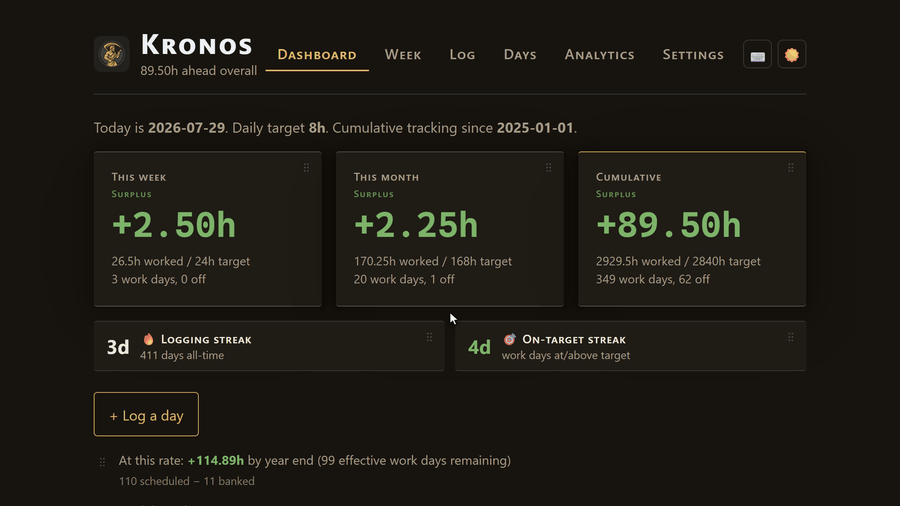

# Kronos ⏱️

> A self-hosted work-hours tracker for people who don't want to open a spreadsheet every morning.

Single-user. No auth. One SQLite file. Runs as a Docker container behind your own reverse proxy.

[](LICENSE)
[](https://www.python.org/)
[](https://fastapi.tiangolo.com/)
[](#tests)



---

## The idea

You have a contracted number of hours per day. Some days you work more, some less. Kronos
answers one question — **am I ahead or behind, and by how much?** — for this week, this month,
and every day since you started tracking.

Log a day in a few seconds, then get out of the way.

---

## Features

### Logging

- **One row per date.** Every day is `work`, `vacation`, `sick`, `holiday`, or `flex`
- **Work days** carry a start time, an end time, and any number of breaks — entered as a
  time range or as raw minutes
- **Partial leave.** A leave day can cover only part of the day — 3h of vacation, a 2h
  sick leave — with the hours worked in the rest of it logged on the same row. The Log tab
  has a slider in hours; the rest of the app shows `vacation · 3h`
- **Clock in / clock out** stamps the current time into the form, for logging as you go
- **Bulk logging** applies one non-work type across a whole date range in a single call
- **Day templates** stored server-side — one click fills a recurring shift
- **Public holiday import** by country and region, with a preview before anything is written
  (Spain from the official BOE list; other countries via [Nager.Date](https://date.nager.at/))
- **Free-text notes** per day, searchable across all entries

### The numbers

- **Week, month, and cumulative surplus/deficit** against your daily target
- **Year-over-year** — this year against the same period last year
- **Date-effective daily target.** If your contract changed mid-year, the target is a timeline,
  not a single number: every day is measured against the target in force *on that date*, so
  cumulative totals spanning the change stay correct
- **Non-work days zero out that day's target**, so period totals adjust on their own. A
  partial leave day zeroes only its leave share (3h off an 8h day leaves a 5h target for the
  hours you worked). `flex` days are the exception — they still charge the whole target,
  draining the surplus you banked
- **Vacation budget** tracking against an annual allowance, in fractional days (a 3h
  vacation on an 8h day uses 0.375 of it; budgets can be 22.5)
- **Time-off planner.** Pencil in vacation, holidays and flex days on a calendar before they
  happen and see where the balance lands at Dec 31 — *on target* (only leave moves it: flex
  drains, vacation is neutral) or *at your pace* — and how much of the vacation budget the plan
  leaves. Drafts don't touch the numbers until you commit them, block by block, with their notes.
  They show as dashed ghost days on every calendar, and the dashboard forecast counts them
  instead of assuming you'll take the whole remaining budget
- **Analytics tab** — a year-at-a-glance heatmap first, then the cumulative trend chart,
  monthly and yearly breakdowns, average surplus per weekday, and records (longest day, best
  month, best/worst year)

### The app itself

- **Draggable dashboard** — reorder the summary cards, streak tiles, and forecast/quick-log
  blocks; the layout persists server-side, not in your browser
- **Logging and on-target streaks**, with milestone toasts at 30 / 100 / 365 days
- **Plan tab** — a year strip of twelve mini months picks the working month; click or drag to
  draft, one ledger for drafts and the time off already logged ahead (commit, remove, delete,
  or open a day in the Log tab from there; logged and past days on its calendar open in Log too)
- **Week view** for the current week at a glance; **Log** tab driven by a calendar picker;
  **Days** tab for the full searchable history
- **Command palette** (<kbd>.</kbd>), keyboard shortcuts, dark and light themes
- **PWA-installable**, with a service worker for the app shell
- **CSV import/export** and full JSON backup/restore
- **Printable timesheet** (Days → **PDF**) — a month, a year, or any range as a clean A4 document:
  every calendar day, hours as 7.50 or 7:30, *Compact* (hours only) or *Full* (target, Δ, running
  Σ), optional notes column and signature lines, light or dark, your name and employer from
  Settings → Profile. Month sections with subtotals when the range spans months; "not logged"
  flags a past work day without an entry. The browser's *Save as PDF* is the PDF — no
  server-side dependency

### Keyboard

| Key | |
|---|---|
| <kbd>P</kbd> <kbd>W</kbd> <kbd>L</kbd> <kbd>D</kbd> <kbd>A</kbd> <kbd>S</kbd> | Plan · Week · Log · Days · Analytics · Settings |
| <kbd>.</kbd> | Command palette |
| <kbd>Ctrl</kbd>+<kbd>Enter</kbd> | Save the current form |
| <kbd>Esc</kbd> | Dismiss / back out |

---

## Stack

| Layer | Tech |
|---|---|
| Backend | FastAPI · SQLAlchemy 2 · Alembic · Pydantic |
| Frontend | Jinja2 · Alpine.js · Pico CSS · Chart.js · SortableJS |
| Storage | One SQLite file (WAL mode) on a Docker volume |
| Vendored | Every JS/CSS dependency lives in `backend/static/vendor/` — **no build step, no CDN calls, no npm** |

---

## Quick start

### Docker

```sh
git clone https://github.com/Loadge/kronos.git
cd kronos
docker compose up -d
```

Open **http://localhost:8765**. First boot runs `alembic upgrade head` and seeds default settings.

The build runs the test suite (everything except the Playwright e2e tests) in an intermediate
`test` stage, and the `runtime` image copies a marker file out of it — so the tests always run,
and if any fail, or none are collected, you don't get an image and the running container is left
alone.

### Reverse proxy

Point your proxy at `http://<host>:8765`. Uvicorn runs with `--proxy-headers`, so the real
client IP reaches the logs.

```nginx
location / {
    proxy_pass         http://127.0.0.1:8765;
    proxy_set_header   Host $host;
    proxy_set_header   X-Real-IP $remote_addr;
    proxy_set_header   X-Forwarded-For $proxy_add_x_forwarded_for;
    proxy_set_header   X-Forwarded-Proto $scheme;
}
```

Works with NGINX Proxy Manager, Caddy, Traefik, and friends.

### Local development

Requires Python 3.12+.

```sh
make install          # pip install -r requirements-dev.txt
make migrate          # alembic upgrade head
make seed             # ~3 months of realistic sample data
make run              # uvicorn on :8765 with --reload
```

---

## Configuration

Environment variables:

| Var | Default | |
|---|---|---|
| `APP_PORT` | `8765` | Internal and published port |
| `TZ` | `Europe/Madrid` | Decides what "today" means everywhere in the app |
| `KRONOS_DATA_DIR` | `/app/data` (container) · `./data` (local) | Where `kronos.db` lives |
| `DATABASE_URL` | derived from `KRONOS_DATA_DIR` | Full override for the SQLAlchemy URL |

Everything else is runtime-editable from the Settings tab or `GET`/`PUT /api/config`, and lives
in the `settings` key-value table:

| Setting | Default | |
|---|---|---|
| `daily_target_hours` | `8.0` | Today's contracted hours per work day |
| `daily_target_timeline` | *(derived)* | JSON `[{effective_from, hours}, …]` — the date-effective target history. Editing the single field above appends to this without destroying past rows |
| `cumulative_start_date` | `2025-01-01` | Where the all-time running total begins |
| `reset_annually` | `false` | Auto-advance the cumulative start to Jan 1 each year |
| `work_week_days` | Mon–Fri | Which weekdays count toward the schedule |
| `vacation_budget_days` | `0` | Annual vacation allowance shown on the dashboard; halves allowed (`22.5`) |
| `default_start_time` · `default_end_time` | `09:00` · `17:00` | Pre-filled on the Log tab |
| `holiday_country` · `holiday_region` | *(none)* | Selection remembered for holiday import |
| `profile_name` · `profile_employer` · `profile_extra` | *(empty)* | Printed in the timesheet header; blank lines are left out |
| `dashboard_layout` | see below | Card/tile/block order for the drag-to-reorder groups |

```json
{
  "hero":  ["week", "month", "cumulative"],
  "tiles": ["yoy", "logging_streak", "on_target_streak"],
  "aux":   ["forecast", "quick_log", "vacation"]
}
```

### A note on the target timeline

If you've always worked the same hours, ignore this — the single "Daily target hours" field is
all you need.

If your contract changed (say 8h → 6h in June), set it under *Advanced: my contracted hours
changed over time*. Without it, a single global target silently misprices every day on the other
side of the change, and your cumulative balance is wrong by hundreds of hours. With it, each day
resolves against the row in force on that date.

---

## Data and backups

The database is `kronos.db` at **`/app/data/`** inside the container, on the **`kronos-data`**
named volume.

- **From the UI** — Settings → *Download backup* writes a portable JSON snapshot (entries +
  settings) that *Restore from file* reads back. CSV import/export sits next to it.
- **From the API** — `GET /api/backup` and `POST /api/restore`.
- **From the host:**

  ```sh
  docker run --rm -v kronos-data:/data -v "$PWD":/out alpine \
    sh -c 'cp /data/kronos.db /out/kronos-$(date +%F).db'
  ```

> Restore **wipes existing data first**. SQLite checkpoints the WAL on connection close; for a
> tighter guarantee, stop the container before copying the file directly.

Backups are **version 2** since partial leave: every entry carries its `fraction`. Version 1
files still restore (their days are whole); an older Kronos refuses a version 2 file rather
than silently flattening partial days. The CSV has a `fraction` column for the same reason —
a CSV without it imports as whole days.

---

## API

Interactive docs at `/docs` once it's running.

**Entries**

| | |
|---|---|
| `POST /api/entries` | Create a day (with breaks; `fraction` < 1 for partial leave) |
| `POST /api/entries/batch` | Apply one non-work type across many dates (optional `fraction`) |
| `GET /api/entries` | List, optional `from`/`to` range |
| `GET · PUT · DELETE /api/entries/{date}` | Read, full replace (atomic break-set swap), delete |

**Analytics**

| | |
|---|---|
| `GET /api/dashboard` | Week + month + cumulative summary |
| `GET /api/streaks` | Logging streak, on-target streak, all-time days logged |
| `GET /api/analytics/cumulative?as_of=` | Balance as of a date (API only — no UI since 2026-10-01) |
| `GET /api/analytics/monthly` · `/yearly` | One row per calendar month / year |
| `GET /api/analytics/records` | Longest day, best month, longest streak, best/worst year |
| `GET /api/analytics/yoy` | This year vs. the same period last year |

**Configuration**

| | |
|---|---|
| `GET · PUT /api/config` | All app-level settings |
| `GET · PUT /api/config/daily-target-schedule` | The date-effective target timeline |
| `GET · PUT /api/config/dashboard-layout` | Card/tile/block order |

**Data in and out**

| | |
|---|---|
| `GET /api/export.csv` · `/api/export.json` | Download entries |
| `GET /timesheet?from&to&detail&hours&notes&sign&theme` | The printable timesheet (HTML, not JSON) — every switch is a query parameter, so a URL is a report |
| `POST /api/import/csv` | Bulk import from a Kronos-format CSV |
| `GET /api/backup` · `POST /api/restore` | Full JSON snapshot / restore (entries, settings, planner drafts) |
| `DELETE /api/data` · `POST /api/data/seed` | Wipe / sample data (admin, testing) |

**Time-off planner**

| | |
|---|---|
| `GET /api/plans?year=` · `POST /api/plans` | Drafts; draft one leave type across dates (re-drafts, skips logged dates) |
| `PUT · DELETE /api/plans/{date}` | Change a draft's type / share / note, or drop it |
| `POST /api/plans/commit` | Turn drafts into real entries (an existing entry wins) |
| `GET /api/plans/projection?year=` | Balance at Dec 31 on target and at pace, vacation left after the plan |

**Holidays and templates**

| | |
|---|---|
| `GET /api/holidays/countries` · `/subdivisions` | Lookups, proxied from Nager.Date (Spain's regions: the BOE table) |
| `GET /api/holidays/preview` · `POST /api/holidays/import` | Preview, then commit |
| `GET · POST /api/templates` · `DELETE /api/templates/{id}` | Day templates |

`GET /healthz` backs the container healthcheck.

---

## Tests

```sh
make test             # pytest — in-memory SQLite, no container needed
make lint             # ruff check + format --check
make e2e              # Playwright end-to-end suite (see below)
make check            # lint, then test, then e2e — what to run before a deploy
```

**521 passing**, across four suites:

| Suite | |
|---|---|
| **Unit** | Net-hours math, break conversions, ISO week/month boundaries, `DayType`, `WorkEntry` properties, the daily-target schedule value object, settings service, partial-day target/net/summary math, the time-off projection, the timesheet rows / totals / hour formatting |
| **API** | Every router — happy paths plus validation failures: duplicate date, end ≤ start, break longer than the span, day-type transitions, invalid config, what a partial leave day may carry, fraction round-trips through backup and CSV |
| **Integration** | Full CRUD flows, dashboard recalculation after state changes, cross-month weeks, export/import round-trips |
| **Regression** | Cumulative start boundary, `as_of` inclusivity, float precision, backup field fidelity (backup → wipe → restore → backup is identical), orphaned-break FK, the non-work zero-target invariant, CSV quoting, per-date target resolution |
| **Repo hygiene** | The models and the Alembic migrations describe the same schema (autogenerate finds nothing to add after `upgrade head`); no phase numbers in code; no file mixes line endings |

### End-to-end

93 Playwright tests drive a real browser against a real uvicorn server: cross-tab journeys,
viewport/responsive checks, the Analytics section order, the partial-leave slider, the planner
(click, drag, commit, notes, delete, opening days in Log, ghosts on the Log calendar), the
timesheet picker and page (including Chromium's own PDF printer), and the smoke script itself. Excluded
from `make test` and from the Docker build (no browser in the image), so `deploy.sh` and
`deploy-staging.sh` run them locally and abort if they fail or collect nothing.

```sh
pip install pytest-playwright
playwright install chromium

pytest tests/e2e -v            # headless
pytest tests/e2e -v --headed   # watch it work
```

### Smoke test

`bin/smoke.py <url>` runs GET-only checks against a running Kronos — `/healthz`, the page,
`app.js`, the dashboard/analytics/planner endpoints and the timesheet, each with its expected
shape — plus a
negative control that must return 404, so a proxy answering 200 to everything cannot fake a
pass. Both deploy scripts run it after the container is healthy and fail if it does.

```sh
python bin/smoke.py https://kronos.example.com   # or: make smoke SMOKE_URL=...
```

### kctl — a disposable Kronos for verifying changes

`bin/kctl.py` starts Kronos on a fresh temporary SQLite DB (never `data/`), so an agent or a
human can check a change without touching real data:

```sh
python bin/kctl.py up --seed                                   # ~3 months of sample data
python bin/kctl.py api GET /api/analytics/monthly
python bin/kctl.py shot "/#analytics" --out .artifacts/analytics.png [--viewport phone] [--theme light]
python bin/kctl.py down                                        # kill it, delete the temp DB
```

---

## Security posture

Kronos assumes a **trusted network** — a VPN, or a private reverse proxy.

- **No auth layer.** The network is the access control
- **No cookies**, so no CSRF surface
- **JSON-only mutation API**, Pydantic-validated on every field
- Container runs as **non-root** (`kronos`, uid 1000)

> ⚠️ Do not put this on the open internet as-is. Put Cloudflare Access, Authelia, or plain
> Basic Auth in front of it — the app itself has no authentication and never checks who you are.

---

## Migrations

```sh
make migrate                           # apply pending
make revision MSG="add new column"     # autogenerate a new one
```

Alembic runs with `render_as_batch=True`, so SQLite-unfriendly `ALTER TABLE` operations (drop
column, alter type) rebuild the table correctly. Settings that are pure key-value — the target
timeline, the dashboard layout — are stored as JSON and need no migration at all.

---

## Layout

```
kronos/
├── backend/
│   ├── app/
│   │   ├── routers/      # entries · analytics · export · config · backup · admin · holidays · templates · plans · timesheet
│   │   ├── services/     # computations · settings · views · timesheet
│   │   └── templates/    # Jinja2 shell + one partial per tab
│   ├── static/           # app.js · styles.css · sw.js · manifest.json · vendor/
│   └── seed.py           # sample-data generator
├── alembic/              # migrations + env.py
├── tests/                # unit · api · integration · e2e
├── docs/
│   ├── BUILD_PHASES.md   # open phases (the roadmap)
│   ├── BUILD_PHASES_ARCHIVE.md  # completed phases: what was decided and why
│   ├── demo.gif          # the README GIF
│   └── demo/             # scripted Playwright recorder that produces it
├── bin/                  # smoke.py (post-deploy checks) · kctl.py (disposable instance)
├── deploy.sh             # one-command deploy to a remote Docker host over SSH
├── Dockerfile            # base → test (pytest, no e2e) → runtime; red tests = no image
├── docker-compose.yml
├── entrypoint.sh         # alembic upgrade head, then uvicorn
├── Makefile
└── pyproject.toml        # ruff + pytest config
```

The demo GIF is reproducible — see [`docs/demo/README.md`](docs/demo/README.md). It records a
scripted tour of a throwaway seeded database, never your real data.

---

## Roadmap

Open phases in [`docs/BUILD_PHASES.md`](docs/BUILD_PHASES.md); completed ones, with the reasons
behind them, in [`docs/BUILD_PHASES_ARCHIVE.md`](docs/BUILD_PHASES_ARCHIVE.md). Next up:

- **BOE resolution discovery** — find next year's Spanish holiday resolution instead of adding
  its id by hand each October

---

## License

[MIT](LICENSE)
